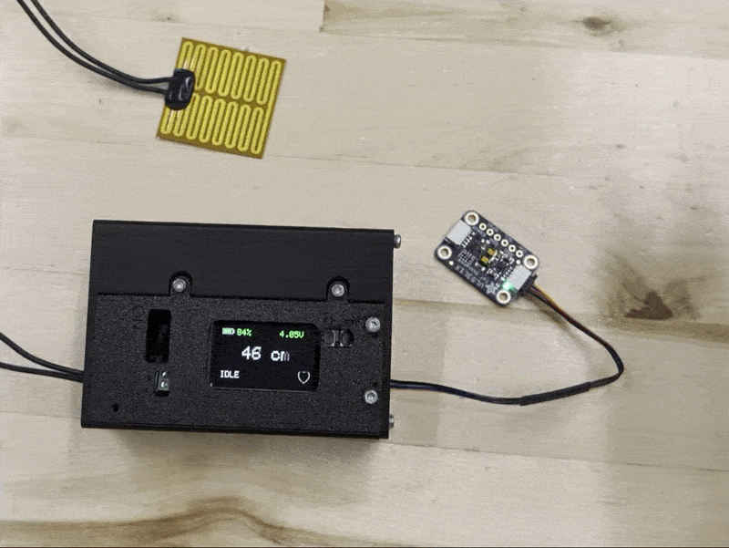

# Heat Pad

Battery-powered pad that warms up when someone stands close. The thermo-graphics visible once the pad is warm, and disappears again as the pad cools.

The controller is an Adafruit ESP32-S3 TFT Feather. It reads a time-of-flight distance sensor, turns a boost converter on and off to feed the heat pad, and draws the live distance, battery level, and heart on its screen. There is no temperature sensor. Timing stands in for how hot the pad is.

Firmware source is in [`heatpad_firmware`](heatpad_firmware). That folder’s README covers wiring and how to upload the sketch.

## Firmware settings

You can change how the pad behaves without uploading new code. Type a command in the Serial Monitor and press Enter.

These settings stay programmed even after a reset or a power cycle. The board stores them in flash, so unplugging the battery does not erase them. They stay in place until you send `defaults`, or until you upload a sketch with Arduino’s “Erase all flash before sketch upload” option turned on.

| Setting | What it does | Factory value |
| --- | --- | --- |
| `heat` | How long the pad stays fully on after someone is first detected. This is the warm-up. | 20000 ms (20 s) |
| `pwm-on` | After the warm-up, the pad pulses to hold temperature. This is how long each pulse stays on. | 100 ms |
| `pwm-off` | How long each pulse stays off. A shorter off time keeps the pad hotter. A longer off time lets it cool more. | 100 ms |
| `near` | Distance at which the pad starts heating. The person must be this close, or closer. | 35 cm |
| `far` | Distance at which the pad turns off. The person must be farther than this. | 40 cm |
| `cool` | After the person walks away, how long the heart on the screen takes to fade. This does not change how fast the paint itself cools. | 10000 ms (10 s) |

`near` has to be a smaller number than `far`. That gap is the difference between “someone stepped in” and “someone walked away.”

Times must be from 50 to 60000 milliseconds. Distances must be from 1 to 200 centimeters. A number outside those limits is rejected, and the old value stays as it was. If a pulse is already running, it finishes the current on or off interval, then uses the new time.

### Commands

| Command           | What it does                                                       |
| ----------------- | ------------------------------------------------------------------ |
| `get`             | Print the settings in use, and whether they were loaded from flash |
| `set heat 15000`  | Set the warm-up time, in milliseconds                              |
| `set pwm-on 500`  | Set the hold pulse on time, in milliseconds                        |
| `set pwm-off 400` | Set the hold pulse off time, in milliseconds                       |
| `set near 35`     | Start heating at or under this distance, in centimeters            |
| `set far 45`      | Stop heating beyond this distance, in centimeters                  |
| `set cool 5000`   | Set how long the on-screen heart takes to fade, in milliseconds    |
| `defaults`        | Put the factory numbers back and erase the saved copy              |
| `help`            | List the commands                                                  |

Pins, how many readings are required before the pad reacts, and the low-battery cutoff live in `heatpad_firmware/config.h`. Those need a new upload to change.

## Bill of materials

| Part | Notes | Link |
| --- | --- | --- |
| Heat pad | Fabric pad warmed by the boost output | [Amazon](https://a.co/d/0cVdlTN0) |
| Time-of-flight sensor | Distance sensor on the Feather STEMMA QT port | [Adafruit 3967](https://www.adafruit.com/product/3967) |
| ESP32-S3 TFT Feather | Controller and display | [Adafruit 5483](https://www.adafruit.com/product/5483) |
| Adjustable boost converter | Pololu 2890. The potentiometer sets the output, up to 20 V. This build uses 5 V. Set and check the voltage with a meter before connecting the pad. | [DigiKey](https://www.digikey.com/en/products/detail/pololu/2890/10451201) |
| Battery | LiPo for the Feather and the boost input | [Adafruit 1781](https://www.adafruit.com/product/1781) |

## Enclosure

The enclosure design is on Autodesk Fusion: [https://a360.co/4A1Bd32](https://a360.co/4A1Bd32)

The circuit board design is in [`KiCAD/Heat_Pad_v1.0`](KiCAD/Heat_Pad_v1.0).
